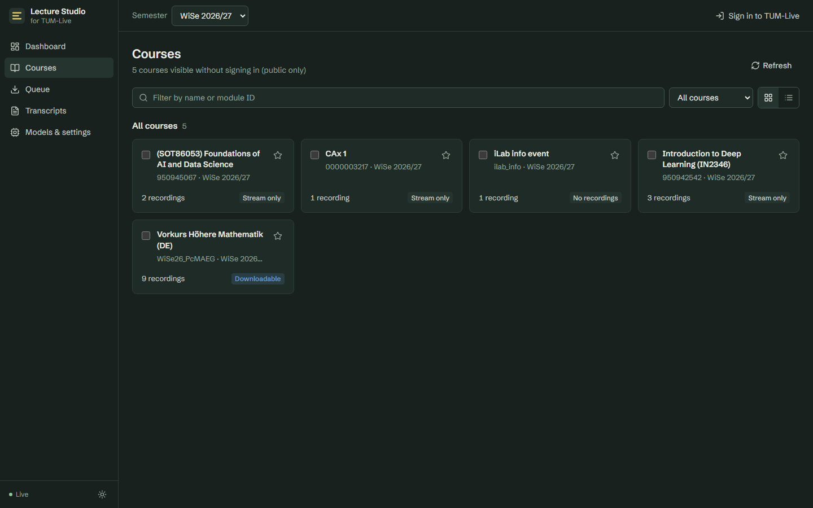
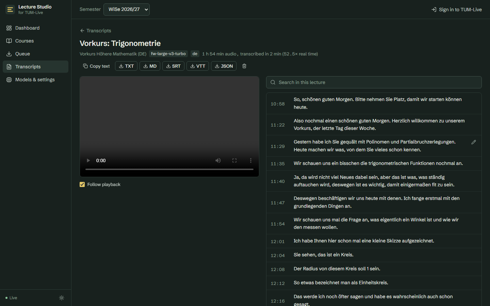

# TUM Lecture Studio

A local-first desktop web app for **downloading TUM-Live lecture recordings and transcribing them on your own
machine**. Browse every course your account can see, pick lectures, watch real download progress, and turn
them into searchable, timestamped transcripts with a local Whisper model. Nothing goes to a cloud service.



> For personal study. By default the app downloads only recordings whose lecturer enabled downloads, using
> TUM-Live's own download links. Optional stream recording saves streams your account can already watch. Keep
> those files to yourself: lecture recordings are the lecturers' work. The app never bypasses MFA, access
> controls or DRM.

## Contents

- [What it does](#what-it-does)
- [Architecture](#architecture)
- [Quick start](#quick-start)
- [Installation by platform](#installation-by-platform) ([macOS](#macos-apple-silicon) · [Windows](#windows) · [Linux](#linux))
- [Signing in](#signing-in)
- [Models](#models)
- [Storage](#storage)
- [Troubleshooting](#troubleshooting)
- [Known limitations](#known-limitations)
- [Verification status](#verification-status)
- [Development](#development)

## What it does

| | |
|---|---|
| **Sign in** | TUM Login (SAML/Shibboleth) from inside the app, including an interactive second-factor step if TUM asks for one; TUM-Live internal accounts; or importing the session cookie from your browser. Public courses work without signing in. |
| **Course explorer** | All courses visible to you in a semester (enrolled, pinned, public, and found by search), as a grid or list with search, filters, favorites, and a highlighted priority section (Diskrete Strukturen IN0015, Einführung in die Rechnerarchitektur IN0004, EIDIP). |
| **Recordings** | Per lecture: date, length, available variants (Combined / Slides / Camera), whether download is permitted, download and transcript status. Download one, many, or a whole course. |
| **Downloads** | Persistent queue with configurable concurrency, real byte progress and speed, resume after interruption (HTTP Range), retries with exponential backoff, fresh signed links per attempt, duplicate detection, integrity check with ffprobe, cancel/retry. Files are organised as `recordings/<2026-WiSe>/<Course>/<date title [variant] #id>.mp4`. |
| **Transcription** | ffmpeg audio extraction → silence-aware chunking → local STT (faster-whisper on NVIDIA/CPU, mlx-whisper on Apple Silicon, or any OpenAI-compatible server) → merge without lost or duplicated words → TXT, Markdown, SRT, VTT, JSON. Optional auto-transcribe after download, German language hint and a technical vocabulary prompt. |
| **Stream recording** (opt-in) | For lectures whose lecturer disabled downloads, the app can record the HLS stream you can already watch on TUM-Live: yt-dlp with parallel fragments and fragment-based progress, resume after interruption, remux to MP4 without re-encoding, ffmpeg as the fallback. Recordings are checked against the exact playlist length. Turn it on under *Models & settings → Record streams*. DRM-protected streams are refused. |
| **Transcript viewer** | Word-by-word highlighting that follows playback, every line clickable to jump there, subtitles in the video (toggle), a *Script only* view with a slim audio player, search (in a lecture and across all lectures), inline editing, copy, export. |
| **Models** | Hardware detection with a recommendation, download/remove models, choose the default, and **measured** speed and memory per model after it has run on your machine. |



## Architecture

```
            Browser (React + TypeScript + Tailwind, served by FastAPI)
                 │  REST  +  Server-Sent Events (live job progress)
   ┌─────────────▼──────────────────────────────────────────────┐
   │ FastAPI backend (Python 3.11)            binds 127.0.0.1    │
   │  tumlive/   API v2 client · SAML login · session store      │
   │  downloads/ HTTP Range downloader · ffmpeg HLS fallback     │
   │  jobs.py    persistent queue (SQLite) · retries · recovery  │
   │  stt/       chunking · merge · engines · model store        │
   │  transcripts/ FTS5 search · exports                         │
   └───────┬──────────────────────────┬─────────────────────────┘
           │ HTTPS                    │ in-process or HTTP
   live.rbg.tum.de/api/v2      faster-whisper (CUDA/CPU) │ mlx-whisper (Metal)
   edge.live.rbg.tum.de        │ host STT companion (OpenAI-compatible)
```

Decisions, with the reasoning in [docs/analysis.md](docs/analysis.md):

* **No browser scraping.** TUM-Live is now a single-page app with a documented API v2 (from
  [TUM-Dev/gocast](https://github.com/TUM-Dev/gocast)), which gives courses, lectures, variants, durations and,
  when the lecturer allows it, signed download links. The older
  [tum_video_scraper](https://github.com/Valentin-Metz/tum_video_scraper) drives Firefox through Selenium. It
  has no license file, so no code from it is reused here.
* **Downloads use the official MP4 download links.** They support HTTP Range, which gives real byte progress
  and resume. HLS remux with `ffmpeg -c copy` is the fallback. Nothing is transcoded.
* **One process, one SQLite file.** No Redis, no broker. Jobs survive restarts: an interrupted download
  resumes from its `.part` file and an interrupted transcription from its last finished chunk.
* **Pluggable STT.** Docker on macOS has no Metal GPU passthrough, so on a Mac the model runs in a small
  native companion service (`lecture-studio-stt`) that the app, native or in Docker, calls over localhost.

## Quick start

Requirements for the native setup: **ffmpeg**, **Python 3.10+** (installed automatically through
[uv](https://docs.astral.sh/uv/)), and **Node 20+** for the first GUI build.

```bash
git clone <this repo> tum-lecture-studio && cd tum-lecture-studio
scripts/start.sh          # macOS / Linux
.\scripts\start.ps1       # Windows (PowerShell)
```

Open http://127.0.0.1:8420. The script picks the right extras: CUDA with an NVIDIA GPU, MLX on Apple
Silicon, CPU otherwise.

With Docker:

```bash
cp .env.example .env
docker compose up -d --build studio                       # CPU image, amd64 + arm64
docker compose --profile gpu up -d --build studio-gpu     # NVIDIA image (Linux, or Windows with WSL2)
```

The container publishes the port on `127.0.0.1` only, and all data lives in `./data` (see [Storage](#storage)).

**Prebuilt image (no build, no login).** CI publishes `ghcr.io/varialbe/tum-lecture-studio:latest`
(amd64 + arm64, so Apple Silicon too) and `:cuda` on every push to `main`. All you need is Docker:

```bash
docker run -d --name tum-lecture-studio --restart unless-stopped   -p 127.0.0.1:8420:8420 -v ~/tum-lecture-studio-data:/data   ghcr.io/varialbe/tum-lecture-studio:latest
```

Then open http://localhost:8420 and install it as an app (below). Update with
`docker pull ghcr.io/varialbe/tum-lecture-studio:latest`, then remove the container and run the same command
again. Your data stays in `~/tum-lecture-studio-data`. On a Mac the container has no access to the Apple GPU,
so transcription runs on the CPU; the native setup (`scripts/start.sh`) uses Metal and is much faster.

### Install it as an app

The GUI is a Progressive Web App. Open http://localhost:8420 and install it:

* **Chrome / Edge** (Windows, macOS, Linux): *Install app* at the bottom of the sidebar, or the install icon
  in the address bar.
* **Safari on macOS 14+**: *File → Add to Dock*.

It then opens in its own window with its own Dock/taskbar icon, and the app shell loads even while the backend
restarts. The backend must be running: Docker starts it again automatically (`restart: unless-stopped`), and
the native setup runs it through `start.cmd` / `scripts/start.sh`. `localhost` counts as a secure origin, so
no certificate is needed. Installing from another machine on the network would need HTTPS and a login in
front of the app, which isn't set up.

## Installation by platform

### macOS (Apple Silicon)

The recommended setup is **native**: MLX runs Whisper on the Metal GPU.

```bash
brew install ffmpeg node
scripts/start.sh
```

The script installs the `mlx` extra, and the Models page then recommends *Whisper large-v3-turbo (MLX,
Metal)*.

If you prefer the app in **Docker**, run the model natively next to it:

```bash
scripts/start.sh companion           # native STT on http://127.0.0.1:8421, uses Metal
echo "TLS_STT_REMOTE_URL=http://host.docker.internal:8421" >> .env
docker compose up -d --build studio
```

Then choose **Host STT companion** as the default model on the Models page. The companion speaks the
OpenAI `/v1/audio/transcriptions` API, so you can point `TLS_STT_REMOTE_URL` at
[vllm-metal](https://docs.vllm.ai/projects/vllm-metal/en/latest/stt/) instead (it serves Whisper and
Qwen3-ASR). Docker Desktop forwards `host.docker.internal` to services on the Mac's localhost. If yours
doesn't, start the companion with `--host 0.0.0.0` and keep the macOS firewall on.

### Windows

```powershell
winget install Gyan.FFmpeg OpenJS.NodeJS.LTS
.\scripts\start.ps1
```

With an NVIDIA GPU the script installs CUDA 12 cuBLAS and cuDNN 9 from PyPI (`nvidia-cublas-cu12`,
`nvidia-cudnn-cu12`). Only a recent NVIDIA driver is needed, not the CUDA toolkit. Docker Desktop with WSL2
can run the GPU image (`.\scripts\start.ps1 docker-gpu`).

### Linux

```bash
sudo apt install ffmpeg nodejs npm     # or your distribution's equivalent
scripts/start.sh
```

For the NVIDIA Docker image, install the
[NVIDIA Container Toolkit](https://docs.nvidia.com/datacenter/cloud-native/container-toolkit/latest/install-guide.html)
and run `docker compose --profile gpu up -d --build studio-gpu`.

## Signing in

Open **Sign in to TUM-Live** in the top bar.

* **TUM Login** (default): your TUM ID and password go straight to `login.tum.de`. The app replays the
  browser's SAML flow. If TUM shows another step (a second factor, an attribute-release consent, a notice),
  the app displays it and you complete it yourself. The app refuses redirects to hosts other than TUM.
* **TUM-Live account**: TUM-Live's internal login form, for accounts that live on TUM-Live itself.
* **Use browser session**: if you already signed in at live.rbg.tum.de (for example with a passkey), copy
  the `jwt` cookie from your browser's developer tools (Application/Storage → Cookies) and paste it.

Only the session cookie is stored (`data/session.json`, owner-only permissions), and only if you tick *Keep
me signed in*. TUM-Live sessions last up to 7 days. When one expires, the app says so and asks you to sign in
again. Passwords are never stored or logged. **Sign out** deletes the saved session.

## Models

| Model | Engine | Download | Runs on | Notes |
|---|---|---|---|---|
| Whisper large-v3-turbo | faster-whisper (CTranslate2) | 1.6 GB | NVIDIA, CPU | Default on NVIDIA and CPU |
| Whisper large-v3 | faster-whisper | 3.1 GB | NVIDIA, CPU | Highest Whisper accuracy, slower |
| Whisper medium / small | faster-whisper | 1.5 / 0.5 GB | NVIDIA, CPU | For weak machines |
| Whisper large-v3-turbo / large-v3 | mlx-whisper | 1.6 / 3.1 GB | Apple Silicon | Default on Macs (native) |
| Host STT companion | OpenAI-compatible HTTP | – | anything | MLX companion, vllm-metal, Qwen3-ASR via vLLM, … |

The Models page shows what is installed and recommends a model for the detected hardware. It shows speed and
peak memory **only from real runs on your machine**. Measured results and the comparison of engines
(faster-whisper, whisper.cpp, mlx-whisper, vllm-metal, Qwen3-ASR, Parakeet/Canary) are in
[docs/benchmarks.md](docs/benchmarks.md) and [docs/analysis.md](docs/analysis.md).

Transcription settings: language (German by default, or auto-detect), precision, voice-activity detection,
and a **technical vocabulary** passed to Whisper as a decoding prompt (Java, RISC-V, Mengenlehre, Induktion,
Bijektion, Register, Rekursion, …). The prompt is only a hint. The app doesn't post-process speech into
mathematical notation.

## Storage

| What | Native default | Docker |
|---|---|---|
| Recordings | `data/recordings/<semester>/<course>/` | `./data/recordings` |
| Transcripts (TXT, MD, SRT, VTT, JSON) | `data/transcripts/<semester>/<course>/` | `./data/transcripts` |
| Models (Hugging Face cache layout) | `data/models/` | `./data/models` |
| Database (jobs, library, search index) | `data/studio.db` | `./data/studio.db` |
| Session cookie | `data/session.json` | `./data/session.json` |

Override the locations with `TLS_DATA_DIR`, `TLS_RECORDINGS_DIR`, `TLS_TRANSCRIPTS_DIR` and `TLS_MODELS_DIR`.
All settings are listed in [.env.example](.env.example).

## Troubleshooting

* **A download sits at "Server preparing file".** TUM-Live's edge server builds the MP4 before sending the
  first byte. In our tests that took 45 seconds to 3 minutes. The app waits up to 10 minutes
  (`download_first_byte_timeout`).
* **"Downloads are not enabled for this recording".** The lecturer turned downloads off. The app only
  downloads what TUM-Live offers for download.
* **"TUM-Live session expired".** Sign in again. Queued downloads can then be retried from the Queue.
* **The login stops with "page without a form" or an unexpected step.** TUM's login page changed or needs
  something the app doesn't know yet. Use *Use browser session*.
* **CUDA isn't detected (Windows/Linux, native).** Check that `nvidia-smi` works, then reinstall with the
  `cuda` extra. On Linux, `LD_LIBRARY_PATH` must include the pip `nvidia/cublas/lib` and `nvidia/cudnn/lib`
  directories (`scripts/start.sh` sets this).
* **Out of GPU memory.** Pick `int8_float16` precision, or a smaller model.
* **The GUI says "GUI not built".** Run `npm ci && npm run build` in `frontend/` and copy `dist/` to
  `backend/lecture_studio/static/`, or rerun the start script.
* **Bound to another address?** The app checks the `Host` header against DNS rebinding. Add your hostname to
  `TLS_ALLOWED_HOSTS`. The app has **no login of its own**, so don't expose it beyond localhost without a
  reverse proxy that adds authentication.

## Known limitations

* Lectures whose lecturer disabled downloads (in WiSe 2026/27 all three priority courses; only 3 of the 69
  courses visible to the test account offer downloads) need *Record streams* turned on. HLS recordings can't
  use HTTP Range, but yt-dlp resumes from the fragments already downloaded.
* Signing in with a passkey alone isn't possible inside the app. Use *Use browser session*.
* The SSO replay depends on TUM's login pages, and only mocked flows are tested (see below).
* Cancelling a transcription stops the job at once, but the current chunk (up to 10 minutes of audio)
  finishes computing in the background.
* No speaker diarisation and no LLM summaries; the goal is accurate transcription.
* Search matches word beginnings with diacritics folded ("uber" finds "über"); it isn't semantic search.

## Verification status

In short: a real TUM SSO login, live course discovery (69 courses incl. all three priority courses), a GUI
end-to-end run (download with crash/resume → GPU transcription of a 115-minute lecture in 131 s → export), and
the CPU Docker image built and run end-to-end on Linux. Not verified: macOS/MLX, the CUDA and arm64 Docker
images, and a real MFA prompt. See [docs/verification.md](docs/verification.md) for exactly what was run, on
which machine, and what was not tested.

## Development

```bash
cd backend && uv venv && uv pip install -e ".[dev,whisper]"
.venv/bin/pytest -q                      # unit tests (mocked network, real ffmpeg)
.venv/bin/ruff check . && .venv/bin/mypy lecture_studio
cd ../frontend && npm ci && npm run dev  # Vite dev server on :5173, proxies /api to :8420
```

End-to-end GUI test against the real TUM-Live (public course, no credentials): start the app, then run
`python scripts/e2e_gui.py`. STT benchmark: `python scripts/benchmark_stt.py <media> --start 600 --seconds 180
--config fw-large-v3-turbo:cuda:float16 …`.

## License

MIT. Third-party components keep their licenses: faster-whisper (MIT), CTranslate2 (MIT), mlx-whisper (MIT),
OpenAI Whisper weights (MIT), FastAPI (MIT), React (MIT), Tailwind CSS (MIT), lucide (ISC), Schibsted
Grotesk (OFL). The TUM-Live API facts come from [TUM-Dev/gocast](https://github.com/TUM-Dev/gocast) (MIT).
